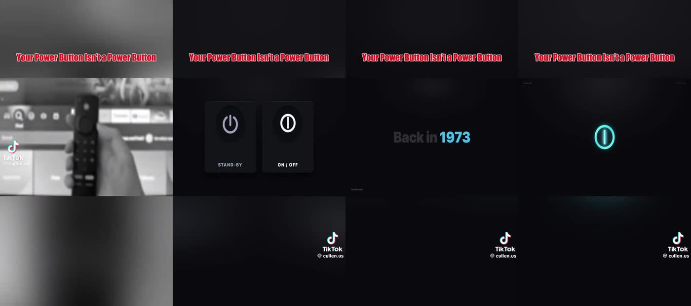
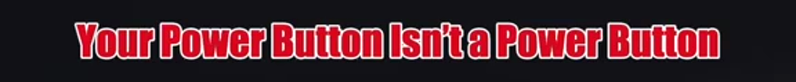
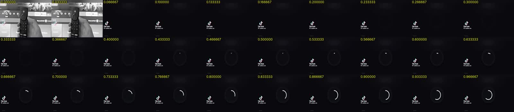
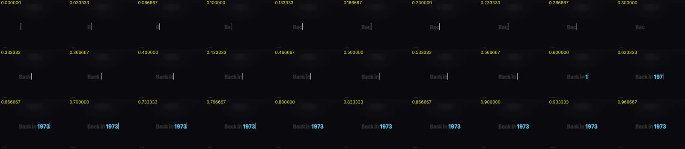
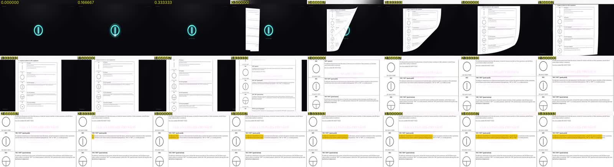
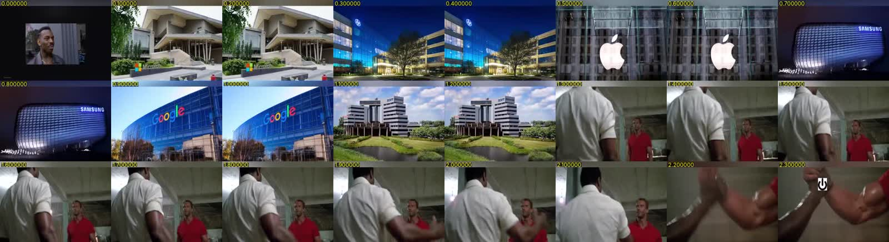
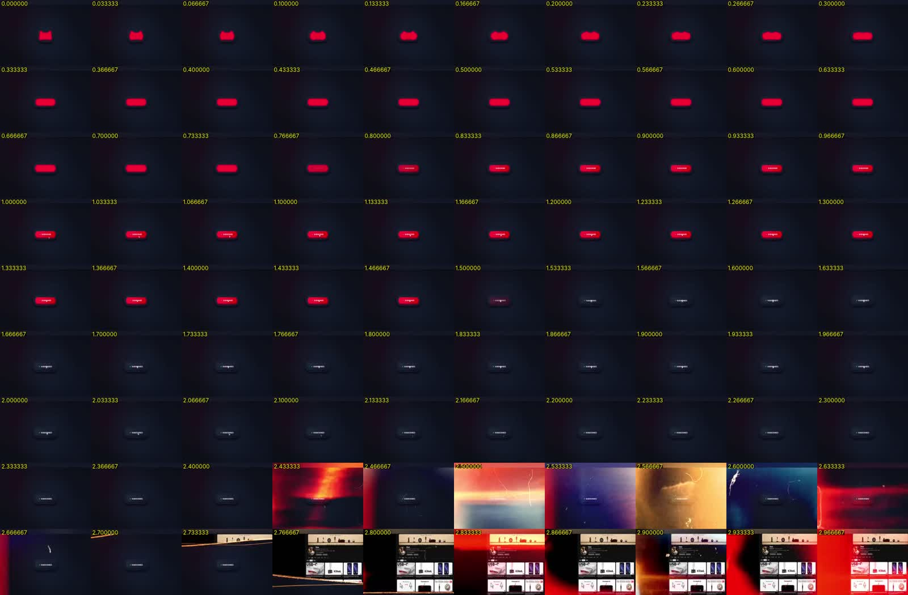
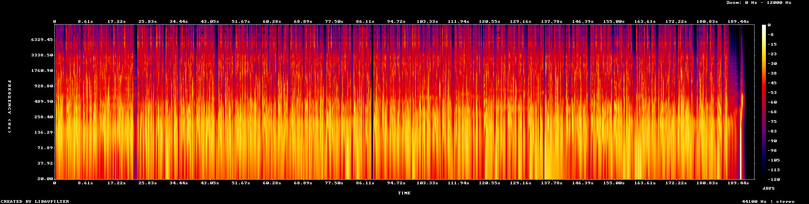

# Deep audit: "Your Power Button Isn't a Power Button"

Reference video: `SHEEPSLIVE_20261026__2114728671445766493_1_21147285317331886080.mp4`, a TikTok short by **@cullen.us** that was re-uploaded to X. The goal of this audit is to measure what makes the format work, so the pipeline in this repo can reproduce the **format** with original content. It does not copy the creator's footage, script, or branding.

All numbers below were measured from the file using ffprobe/ffmpeg (`scdet`, `signalstats`, `ebur128`, `silencedetect`, `showspectrumpic`), faster-whisper `small.en` with word timestamps, and librosa (HPSS, onsets, pYIN pitch). The raw data is in [`data/`](./data). You can re-run the whole audit on any video with `vidsk audit <file>` (see `packages/cli`) or the `video-audit` skill.

---

## 1. Container and encoding

| Property | Value | Notes |
| --- | --- | --- |
| Container | MP4 (`isom`), muxer "Twitter-vork" | X re-encode of a TikTok export |
| Duration | 193.747 s (3:13.7) | Video 193.733 s, audio 193.747 s |
| Video | H.264 High@3.1, 576×1024 (9:16), yuv420p, progressive | **Low resolution** (X serves 576p). Produce at 1080×1920 and let platforms downscale |
| Frame rate | 30 fps nominal; measured frame Δt 33.0–34.0 ms (median 33.3) | Effectively CFR 30. The ±1 ms jitter comes from the 1/1536000 timebase |
| Frames | 5,812 | |
| Video bitrate | 278 kb/s | Heavily compressed. Ship a 10–16 Mb/s master |
| Audio | AAC-LC 44.1 kHz stereo, 128 kb/s | Ship 48 kHz / 192–320 kb/s |
| Created | 2026-10-26T14:39:55Z | |

**Takeaway:** the master should be 1080×1920, 30 fps, H.264 High at CRF ≈ 18 (or 12–16 Mb/s), and AAC 48 kHz at 192 kb/s. Every platform recompresses, so the cleaner the master, the better the result.

## 2. Screen layout (the "framed explainer" format)

Measured on the 576×1024 frame and scaled to the 1080×1920 production canvas:

| Zone | 576×1024 rows | 1080×1920 px | % of height | Contents |
| --- | --- | --- | --- | --- |
| Top safe / blurred fill | 0–175 | 0–328 | 0–17 % | Blurred, scaled copy of the current media (a "blur-fill" background) |
| **Title band** | 180–204 (text cap height ≈ 24 px) | ≈ 338–383 | 17.6–19.9 % | Persistent headline, the same on every frame |
| Gap | 205–260 | 384–488 | | Blur fill |
| **Media window** | **261–656** (h = 396) | **489–1230** (h = 742) | 25.5–64.1 % | Full-width 1080×742 (**16:11**, ≈1.455:1) window. Holds b-roll, memes, motion graphics and documents |
| Lower blur / UI zone | 657–1024 | 1231–1920 | 64–100 % | Blur fill only. Platform UI (caption, handle, buttons) sits here. Watermark sits at the right |

* The **title** is set in a heavy condensed grotesque (Impact/Anton-like), filled red **#D20922** (measured median RGB 210, 9, 34), with a ~2 px white stroke and a soft dark drop shadow. It is one line, centred, and fills about 86 % of the frame width.

  

* The **media window** is always full-bleed horizontally with hard top and bottom edges. All the "content" lives inside the 25–64 % band, which is exactly the platform-safe region for TikTok, Reels and Shorts (the right-hand rail and bottom caption area never cover it).
* The **background** is the same media, scaled to cover, Gaussian-blurred (σ ≈ 30–40 px at 1080p) and slightly darkened. Because of this, every shot fills the whole 9:16 frame even though the content is 16:11. This is the cheapest way to make a landscape asset native to vertical video.
* A watermark/handle sits at the lower right inside the blur zone.

**Why it works:** the persistent title acts as a hook that every frame carries. Viewers who arrive mid-video, or who scroll back, always see the claim. The fixed window means any 16:9 or 4:3 asset (stock, memes, screenshots, UI animation) can drop in with no reframing.

## 3. Edit rhythm and shot grammar

* **76 hard cuts** (ffmpeg `scdet` ≥ 8), or 74 at `select gt(scene,0.25)`. **Median shot 0.90 s, mean 2.49 s**, min 0.033 s, max 19.7 s.
* Pacing is **bimodal**:
  * *Enumeration montages* use 0.20–0.27 s per shot (6–8 frames), always on lists in the VO ("Phones, laptops, consoles…", "every company on earth" → Microsoft/HP/Apple/Samsung/Google/Sony HQs at exactly 0.2 s each, "so many main switches" → 8 products at 0.27 s each).
  * *Explanatory holds* last 4–20 s on a single animated diagram (the standby/on-off button cards hold from 30.5 to 41.9 s while the animation does the work).
* **Transitions:** about 97 % are hard cuts. The exceptions are:
  * A 3D **page-turn** reveal of the standards document (≈0.5 s), followed by a crop-zoom and a **highlighter sweep** (#FFD400 at about 50 %, left to right, about 0.5 s per line).
  * A **shape morph**: the power icon squashes into a red pill (about 0.33 s), which becomes the Subscribe button.
  * One **light-leak / film-burn** transition (9 frames ≈ 0.3 s) into the channel-page scroll.
* **Reaction/meme inserts** come every 20–40 s (a crowd brawl tagged "Tech Industry", the "Roll Safe" thinking guy, the Predator handshake with the power icon over the hands, Dr. Evil "OFF", Denzel "safety is first", a sitcom clip with a "modern electronics" tag). Each is 1.5–4 s and labelled with a **white rounded tag** (black text) that names the analogy.
* **B-roll** is literal: each noun in the VO gets its own shot within about 0.3 s of the word. The visual lands on the anchor word.
* **Typewriter year cards:** "Back in **1973**" and "By **2004**" on near-black. The lead-in words are dim grey (#3A3D45) and the year is bold accent blue (**#4CC0E4**), with a blinking caret. Characters arrive at about 1 every 2–3 frames (about 12 cps), and the year appears about 0.6 s in.
* **Diagrams** are custom dark-UI motion graphics: neumorphic cards on #0A090E, icons drawn on with an animated stroke (`stroke-dashoffset` over about 0.6 s, ease-out, starting from the 12 o'clock gap), small-caps letter-spaced labels ("STAND-BY", "ON / OFF", "POWER", "SLEEP"), and state colours of cyan glow **#20FFF6** (on), orange (standby), red (power) and violet (sleep moon). A small "ZeroDecoder" credit appears in the corner, which suggests the diagrams were made as HTML/CSS animations. That makes them a natural fit for HyperFrames.

**Contact sheets (1 frame/s):** [1](img/contact_01.jpg) · [2](img/contact_02.jpg) · [3](img/contact_03.jpg) · [4](img/contact_04.jpg) · [5](img/contact_05.jpg) · [6](img/contact_06.jpg)

## 4. Colour and light

* Mean luma (Y) is 83.7/255 and mean saturation is **5.8**, so the piece is very dark and low-chroma overall. Colour is reserved for meaning (red title, cyan "on", blue years, red Subscribe).
* Two base looks alternate: **dark UI** (#0A090E–#14151B) for the diagrams, and **natural or desaturated stock** for b-roll. Some b-roll is graded black and white (the opening remote, the 1980s hi-fi).
* Palette tokens derived for the style pack:

| Token | Hex | Use |
| --- | --- | --- |
| `title` | `#D20922` | Persistent headline fill |
| `titleStroke` | `#FFFFFF` | 2 px outline |
| `bg` | `#0A090E` | Motion-graphic background |
| `card` | `#16171D` | Neumorphic card |
| `muted` | `#3A3D45` | Typewriter lead-in |
| `accent` | `#4CC0E4` | Years, key numbers |
| `on` | `#20FFF6` | "On" glow |
| `standby` | `#FF9F1C` | Standby state |
| `danger` | `#E50914` | Subscribe / power red |
| `highlight` | `#FFD400` | Document highlighter |

## 5. Voice-over

| Metric | Value |
| --- | --- |
| Words | 548 |
| Speaking rate | **≈172 wpm** (fast for an explainer; typical is 140–160) |
| Pitch (f0) | Median **122 Hz**, p10 to p90 92–191 Hz. Male, wide intonation range (expressive, not monotone) |
| Gaps between words | Median 0 ms (continuous). Sentence gaps of 0.3–0.6 s. 52 gaps over 350 ms |
| Delivery | Conversational, second person ("you", "your couch"), rhetorical turns ("Except…", "Which means…", "For, you know, safety reasons.") |

### Script structure (timestamps from the transcript)

| Beat | Time | Function | Lines (paraphrased) |
| --- | --- | --- | --- |
| Hook | 0.0–7.5 | Imperative plus physical interaction | "Look at the power button on whatever you're holding right now." |
| Universality | 7.9–21.8 | Raise the stakes | All devices use it, yet the industry agrees on nothing else |
| **Twist** (music drops to silence at 21.85 s) | 22.8–44.3 | Pattern break | The rulebook has a second symbol, a closed circle that is the real "off". Companies stopped using it *because nothing turns off anymore* |
| History | 45.3–87.7 | Context with a typewriter year card | 1973, multilingual faceplates, IEC line and circle, physical switches |
| **Mechanism** (second music drop at 87.73 s) | 88.5–130.2 | How it actually works | Remote control IR sensor, live circuit, "standby" was the original name |
| Modern consequences | 131.0–160.1 | Relatable proof | iPhone, Windows restart vs shutdown, 2004 rule change, the moon symbol |
| Payoff / fear | 160.9–177.0 | Emotional close | "Our machines never really go to sleep… eavesdropping on you." |
| CTA tied to the topic | 177.8–186.5 | Subscribe through the metaphor | "Your power button's been lying to you… The subscribe button won't." |
| End card | 186.6–193.7 | Silent handle card (TikTok outro) | No speech. (Whisper hallucinated "Thanks for watching!" at 190 s over silence, which is a known Whisper failure on non-speech and is guarded against in `packages/core/src/transcript.ts`) |

**Formula:** *Hook with a physical action → universal claim → twist (with an audio drop) → history → mechanism → modern proof → emotional payoff → CTA that reuses the metaphor.* Every 20–40 s there is a new "turn" word ("Except", "Then came", "Once", "Today", "By 2004") that resets attention.

## 6. Music, SFX and mix

| Metric | Value | Recommendation |
| --- | --- | --- |
| Integrated loudness | **−14.3 LUFS** | On target for TikTok, Reels and Shorts (−14 ± 1) |
| Loudness range | **2.4 LU** | Heavily compressed VO. Fine for phones |
| True peak | **+0.1 dBFS** (inter-sample clipping) | ✗ Limit to **−1.0 dBTP** (the pipeline enforces this) |
| VO level (speech frames) | −17.7 dBFS RMS median | |
| Bed level (non-speech) | **−31 dBFS** median, about **13 dB under the VO** | Bed at about −26 to −30 LUFS under VO, ducked 10–14 dB |
| Music bed | Continuous, with a narrow tonal drone around 1–1.1 kHz (visible as a horizontal line in the spectrogram). Global tempo estimate about 129 BPM. Low-band energy is only 0.39× of speech frames, so a light bed | Minimal ambient/tech pulse, 110–130 BPM, no lyrics |
| **Music drops** | **21.85 s (−58.5 dBFS)** and **87.73 s (−49.6 dBFS)**: full cuts to near-silence for 0.4–0.9 s right before the twist lines | The pipeline's `beat.drop` marker reproduces this |
| SFX and meme audio | Spikes of −18 to −21 dBFS at 8–10 s (device clicks), 83.2, 115.9, 119.0, 136.1 and 149.4 s, all aligned with meme inserts or UI clicks | Each SFX 3–6 dB over the bed, peak one frame after the picture |
| Percussive onsets on cuts | Only 2 of 74 cuts have a percussive onset within 120 ms | **Cuts are not whoosh-scored.** SFX are reserved for on-screen actions (clicks, button presses) and meme audio |
| Tail | 2.9 s digital silence over the end card | Keep ≤ 1.5 s, or score it, since silence reads as "video over" and hurts loop retention |

## 7. What to replicate, and what to improve

**Replicate:** the persistent headline and 16:11 window with blur-fill; literal b-roll on anchor words; 0.2 s enumeration montages; dark UI diagrams with stroke draw-on; typewriter year cards; labelled meme or analogy inserts every 20–40 s; music drops before the twist; ≈170 wpm conversational VO; a CTA that reuses the topic's metaphor; −14 LUFS.

**Improve (built into the pipeline defaults):**

1. True peak at −1 dBTP (the reference clips at +0.1 dBFS).
2. Burned-in **captions** in the lower-safe part of the window. The reference has none, and most viewers watch muted.
3. 1080×1920 master at a high bitrate (the reference is 576p at 278 kb/s).
4. A shorter end-card tail (≤ 1.5 s), or a seamless loop back to the hook.
5. Licensed or original visuals only. Replace movie and TV meme clips with generated or licensed analogy shots (the `analogyInsert` scene type) so the output is safe to monetize.
6. An on-screen source citation for factual claims (the `sourceCard` overlay), sourced from the research step.

## 8. How the audit maps to this repo

| Finding | Implemented as |
| --- | --- |
| Layout bands, palette, typography | `packages/core/src/styles/framed-explainer.ts` (style pack `framed-explainer`) |
| Scene vocabulary (b-roll, montage, diagram, typewriter, doc highlight, analogy insert, CTA morph) | `packages/core/src/hyperframes/scenes/*` |
| Anchor-word timing, montage at 0.2 s, music drops | `packages/core/src/timing.ts`, `packages/core/src/audio-plan.ts` |
| Story formula | `prompts/script.md`, `skills/explainer-video/SKILL.md` |
| Loudness, true-peak, ducking | `packages/renderer/src/mix.ts` (ffmpeg `loudnorm` two-pass + `sidechaincompress`) |
| Re-running this audit on any file | `packages/renderer/src/audit.ts`, `skills/video-audit/SKILL.md` |
